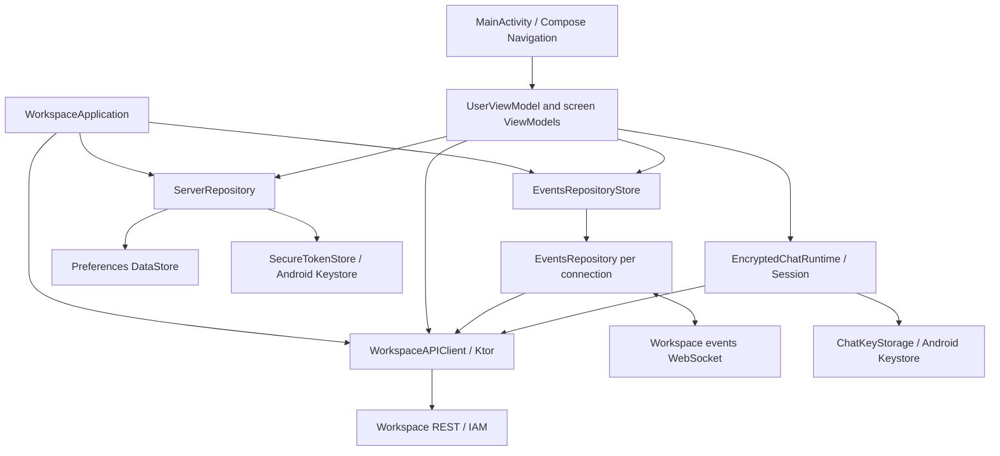

# Architecture

## Application boundaries

The project contains one Android module, `:app`. It implements a Workspace client;
the backend, IAM, and calling provider are separate systems. The HTTP contract
lives in `data/remote/dto/`; the server enforces server-side access rules.

Source paths below are relative to
`app/src/main/java/ru/genesiscorporation/workspace/beta/`.

Dependencies are assembled manually. `WorkspaceApplication` is declared in the
manifest, with its implementation in `MainActivity.kt`. The Application creates
the shared Ktor client, `WorkspaceAPIClient`, `SecureTokenStore`,
`EventsRepositoryStore`, and `ServerRepository`. `MainActivity` attaches the API
client to `UserViewModel`. Screen models use factories in
`ViewModelFactories.kt`. The project has no separate DI container or Gradle
feature modules.

## Presentation and navigation

`MainActivity.kt` contains the Compose entry point and navigation graphs.
`Destinations.kt` defines serializable routes for authentication, the main screen,
conversations, and profile. `ApplicationSwitcher` waits for local settings to
load, then selects organization setup, login/project selection, or the main app.

Each `modules/<feature>/` directory contains a screen and its ViewModel; more
complex operations are extracted into nearby classes. A model receives its
repository and client through a factory, runs work in `viewModelScope`, and
exposes `StateFlow`. Compose renders state and invokes model actions. Shared
components, avatars, and the theme live in `ui/`.

`UserViewModel` exposes the selected connection, settings, and credentials.
`WorkspaceViewModel` holds the current call message and sends the FCM token.
`ServerRepository` passes persisted connection changes to `EventsRepositoryStore`,
which creates, replaces, and closes each connection's `EventsRepository`.
Each `EventsRepository` owns its coroutine scope and realtime connection,
including reconnection, event probes, and cursor recovery.

Connections are selected by the local `ServerConfig.id`. The server address and
`projectUuid` are separate fields and do not replace that ID.

## Storage and state scope

| Data | Owner / mechanism | Lifecycle |
| --- | --- | --- |
| Connections, selected ID, unread ordering | `ServerRepository`, Preferences DataStore `settings` | Persist across launches |
| Access/refresh tokens and the confirmed owner used for cleanup | `SecureTokenStore`, EncryptedSharedPreferences `secure_tokens` | Scoped to connection ID and protected by Android Keystore |
| Channels, topics, members, folders, messages, drafts, cursor | `EventsRepository`, `MutableStateFlow`, and in-memory collections | Reloaded from the API; repositories close when a connection is removed or replaced |
| Encryption keys and unfinished exchanges | `ChatKeyStorage`, `EncryptedChatKeyStore` | Separate encrypted storage scoped by server/project/user/device/stream/key |
| Quotes, message selection, composer, decrypted presentation | Screen model / `EncryptedChatRuntime` | Scoped to the current screen and verified account |
| Downloaded attachments | `AttachmentStorage` and file cache | Local files shared with external apps through FileProvider |

`EventsRepositoryStore` keeps repositories by connection ID. `syncWith` creates
missing instances and closes removed ones; a configuration change replaces an
incompatible instance. `ServerRepository` serializes session changes with a mutex:
a late refresh must not overwrite newer credentials or restore a removed
connection.

The project has no Room database containing the full history or general durable
offline action queue. Optimistic messages and persisted cryptographic exchange
state do not provide such a queue.

## HTTP and authentication

The API/realtime and avatar clients use `workspaceHttpClient`. Its sending hook
requires HTTPS/WSS for remote hosts, including redirect targets. Plain HTTP/WS
is limited to the exact loopback hosts `localhost`, `127.0.0.1`, and `::1` for
local development. A blocked request never reaches the engine, and its error
does not include the URL or credentials.

`data/remote/APIClient.kt` defines `ApiRequest<RequestData, Response, Error>`:
relative URL, HTTP method, body, credential requirement, additional headers, and
multipart data. The production transport is in `WorkspaceAPIClient.kt`.
New operations use `performRequest` and a separate DTO. Account-sensitive
operations pass the captured `serverId` and `serverConfig`; protected mutations
also use `ProtectedRequestAuthentication`.

GET data is serialized with Kotlin Serialization Properties and appended to the
URL. List index suffixes become repeated query keys. Kotlin Serialization handles
JSON bodies; file uploads use multipart. Responses accept unknown JSON fields.
The result is `ApiResult.Success` or `ApiResult.Error(ApiError)`. The error model
keeps the backend code, message, and actual HTTP status separate. Initial responses
and retries after refresh use `responseError`: structured `msg`/`code` fields are
preserved, while unrecognized bodies retain their raw text and HTTP status code.
`ApiError.message` exposes `errorMessage` through the `Throwable` contract even
after JSON decoding; blank text uses a readable fallback for consumers such as
the login and OTP Toasts. The raw `errorMessage` and serialized fields stay unchanged.
The screens consume a displayed error by returning to Idle, so identical fast
responses still produce a new Toast when the intermediate Loading frame is skipped.
`ApiErrorTest`, `ResponseErrorTest`, `WorkspaceRequestHttpContractTest` and
`AuthenticationErrorUiTest` cover these boundaries.

IAM login and refresh use
`/api/core/v1/iam/clients/default/actions/get_token/invoke` without a Bearer header.
Login supports `X-OTP`. A regular request receiving 401 may retry once after a
refresh. A mutex coalesces concurrent refreshes; saving the result checks the
previous refresh token. A temporary network or server failure alone must not
delete a session. A protected operation also checks its original context so that
a late response cannot affect a replacement login.

`downloadFile` reads the body in 64 KiB chunks into a temporary `.part` file next
to the destination. It keeps a 32 MiB free-space reserve, checks the length of an
uncompressed response, and atomically replaces the destination. Cancellation or
failure removes the temporary file. Uploads differ: their source bytes may be
held in memory.

## Events and HTTP snapshot reconciliation

`EventsRepository.kt` loads server settings and entities, applies events, and
publishes updated flows. The WebSocket endpoint is
`/api/workspace/v1/events/ws`; HTTPS becomes WSS, HTTP becomes WS, and an explicit
port is preserved. Authentication uses the subprotocol
`workspace.events.v1, bearer.<access-token>`.

The cursor consists of `epoch_generation` and `last_epoch_version`. A boundary is
captured before snapshots, then later events are replayed. Reconnection uses a
backoff from 1 to 30 seconds. An HTTP probe every 30 seconds detects missed visible
events.

Close code 4410, an HTTP 410 probe response, and the typed `epoch_pruned` frame
trigger cursor recovery. The open conversation receives fresh history; inactive
caches are marked stale and reloaded when opened. Unavailable history for an
inactive chat must not delay a working connection.

Concurrent paths require explicit reconciliation:

- `MessageHistorySnapshot.kt` merges HTTP history with pending sends and message
  creation/edit/deletion events received during the request.
- `StreamMembershipState.kt` preserves membership changes received after a member
  snapshot started.
- Recovery and stream-deletion revisions reject obsolete responses.
- Counters, the selected folder, and its contents update together with the shared
  catalog; read/mute/topic overrides affect active unread state.

## Encrypted chats and external resources

Cryptography is split between `data/crypto/` (format and storage),
`EncryptedChatSession` (exchanges and decisions), and `EncryptedChatRuntime`
(UI/repository binding). `EventsRepository` retains ciphertext; decrypted
messages and previews form a separate projection. Reading or changing keys
requires a verified `/me`, current credentials, and membership. Logout, context
changes, revoked access, and local key deletion invalidate the associated
presentation. See [encrypted-chats.md](encrypted-chats.md) for the full contract.

Messages are encrypted, but attachment bytes and metadata use the regular
upload/download endpoints. Keys are not granted automatically; transfer between
devices uses an authenticated request/grant exchange.

Coil avatar requests use `ui/AvatarImageRequest.kt`. Credentials are allowed for
the selected Workspace origin and removed when a redirect changes the origin;
the client rejects HTTPS-to-HTTP redirects. `modules/share/WorkspaceShare.kt` builds
contact and channel links from the exact origin and UUID. These are web links;
the manifest's launcher does not declare a general VIEW handler.

The FCM service lives in `data/MyFirebaseMessagingService.kt`; notification
intents pass `deeplink` to `MainActivity`. The bouncer's `BaseChatMessage` emits
non-negative decimal `workspace_message_id` values; `RemoveNotificationMessage`
emits a comma-separated `message_ids` list. `NotificationMessageId` rejects
missing or malformed values and canonicalizes leading zeros. Small IDs retain
the old untagged Android notification key; wider integers use a full decimal
tag without truncation or hashing. Each removal is validated independently.
The same canonical identity distinguishes immutable activity PendingIntents,
so updating one message changes only its own extras. The current UI retains
the delivered deeplink but does not yet resolve it to a chat; legacy numeric
sender IDs also need a defined mapping to Workspace UUIDs.

Calls launch the Jitsi SDK from a chat
or channel information screen. This separate integration requires provider and
device-permission checks.

## Crash diagnostics

Firebase provider discovery initializes Crashlytics before the application for
uncaught Java/Kotlin crash reports. Debug manifests disable automatic collection;
release builds use the SDK default and the Crashlytics Gradle plugin associates
R8 mappings with the injected build ID. The application adds no custom crash
logs, user identifiers or Analytics integration. Firebase reporting and Play
Android vitals are independent delivery paths. See [development](development.md)
for local build exclusions and publication acceptance.
